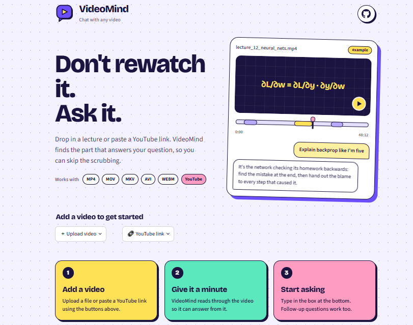
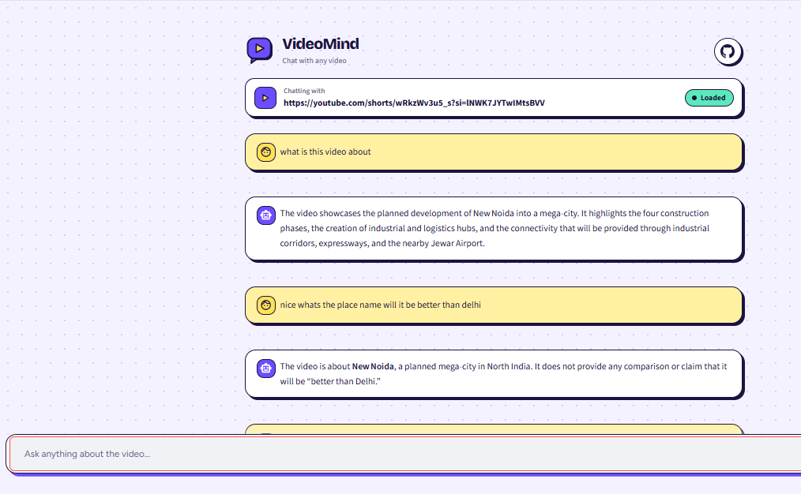
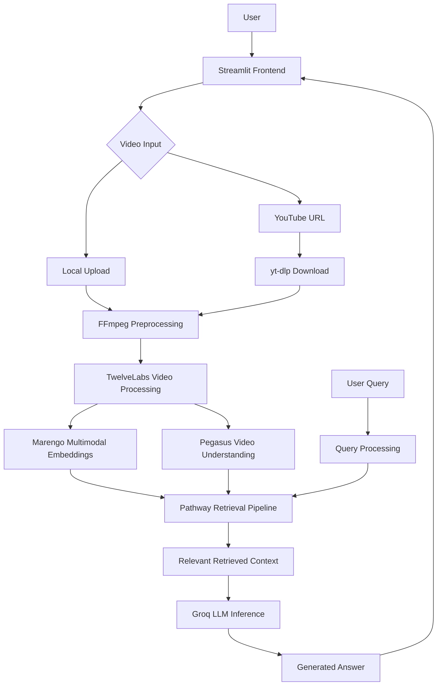

# 🎥 VideoMind — Multimodal Video RAG System

### Don't rewatch it. Ask it.

**An AI Video Retrieval-Augmented Generation (RAG) system that transforms video content into an interactive, searchable knowledge source.**

VideoMind is a multimodal RAG application built to make long-form video content accessible through natural-language conversations. Users can upload local videos or provide YouTube URLs, allowing the system to process video content, retrieve relevant contextual information, and generate answers to questions using Large Language Models.

The system integrates **TwelveLabs for video understanding and multimodal embeddings, Pathway for the retrieval pipeline, and Groq for LLM inference**, with a Streamlit interface for user interaction.

---

## 📸 Application Preview

### Landing Page

Upload a video or provide a YouTube URL to create a searchable source of video knowledge.



### Interactive Video Question Answering

Ask questions about the video, retrieve relevant context, and continue the conversation through an interactive chat interface.



---

## ✨ Core Features

- **Multimodal Video RAG:** Built a retrieval-augmented generation pipeline to interact with video content using natural-language queries.
- **Video Understanding:** Integrated TwelveLabs Pegasus for video analysis and Marengo for multimodal embedding generation.
- **Semantic Retrieval:** Retrieve relevant video information based on query meaning and contextual similarity.
- **YouTube Video Ingestion:** Accept YouTube URLs as an alternative to local video uploads.
- **Video Preprocessing:** Integrated FFmpeg for video normalization, frame-rate reduction, and format compatibility.
- **Context-Aware Question Answering:** Combine retrieved video context with Groq-powered LLM inference to generate relevant responses.
- **Conversational Interface:** Built an interactive Streamlit chat interface supporting follow-up questions.
- **Backend Containerization:** Used Docker to package and run the Pathway backend independently of the frontend.

---

## 🏗️ System Architecture

VideoMind follows a modular architecture separating video ingestion, multimodal processing, retrieval, and answer generation.



---

## 🔍 RAG Pipeline — How VideoMind Works

### 1. Video Ingestion

The application accepts video input through:
- Local video uploads.
- YouTube video URLs.

For YouTube videos, `yt-dlp` handles video downloading.

### 2. Video Preprocessing

FFmpeg prepares videos for downstream processing by:
- Normalizing video formats.
- Standardizing frame rates and resolution.
- Processing audio streams.
- Improving compatibility with the video understanding pipeline.

### 3. Multimodal Video Understanding

TwelveLabs models power the video intelligence layer:

- **Pegasus:** Video understanding and content analysis.
- **Marengo:** Multimodal video embedding generation.

This layer enables the application to work with information contained in video content rather than treating videos as ordinary text documents.

### 4. Indexing and Retrieval

Pathway manages the backend processing and retrieval pipeline.

The processed video representations are made available for retrieval so that user questions can be matched against relevant video context.

### 5. Query Processing

Users submit natural-language questions through the Streamlit chat interface.

The backend processes the query and retrieves context relevant to the requested information.

### 6. Contextual Answer Generation

The retrieved context is passed to the Groq-hosted LLM, which generates a response grounded in the available video information.

### 7. Interactive Conversation

The generated response is returned to the frontend, where users can ask further questions and explore the video's content conversationally.

---

## 🛠️ Tech Stack & Concepts

| Category | Technologies |
|---|---|
| Programming Language | Python |
| Frontend | Streamlit |
| Backend | Pathway |
| RAG Architecture | Retrieval-Augmented Generation |
| Video Understanding | TwelveLabs Pegasus |
| Multimodal Embeddings | TwelveLabs Marengo |
| LLM Inference | Groq |
| Video Processing | FFmpeg |
| YouTube Ingestion | yt-dlp |
| Containerization | Docker |
| API Communication | HTTP / REST |

### Technical Concepts Implemented

- Retrieval-Augmented Generation (RAG)
- Multimodal AI and Video Understanding
- Semantic Search and Embeddings
- Context Retrieval and LLM Grounding
- Video Ingestion and Preprocessing
- Modular Backend Architecture
- API Integration and Containerization

---

## 📁 Project Structure

```text
VideoMind/
│
├── streamlit_app.py
├── streamlit_app_old.py
│
├── app.py
├── app.yaml
│
├── Dockerfile
│
├── requirements.txt
├── requirements-streamlit.txt
│
├── screenshots/
│   ├── landing_page.png
│   └── chat_interface.png
│
├── .env.example
├── .gitignore
│
└── README.md
```

---

## ⚙️ Local Setup

### Prerequisites

- Python
- Docker Desktop
- FFmpeg
- Git
- TwelveLabs API key
- Pathway license key
- Groq API key

### 1. Clone the repository

```bash
git clone https://github.com/Harshit-0021/VideoMind.git
cd VideoMind
```

### 2. Create a virtual environment

```bash
python -m venv .venv
```

Activate on Windows:

```powershell
.venv\Scripts\activate
```

### 3. Install frontend dependencies

```bash
pip install -r requirements-streamlit.txt
```

### 4. Configure environment variables

Create a `.env` file using `.env.example`:

```env
TWELVELABS_API_KEY=your_api_key
PATHWAY_LICENSE_KEY=your_license_key
GROQ_API_KEY=your_api_key
```

Never commit API keys or your `.env` file to GitHub.

### 5. Build the backend Docker image

```bash
docker build -t videomind .
```

### 6. Start the backend

PowerShell:

```powershell
docker run --rm `
  -v "${PWD}/data:/app/data" `
  --env-file .env `
  -p 8000:8000 `
  videomind
```

### 7. Launch the frontend

Open another terminal:

```bash
streamlit run streamlit_app.py
```

Open the application at:

`http://localhost:8501`

---

## 🚀 Deployment

The application uses a decoupled frontend and backend architecture.

| Component | Hosting |
|---|---|
| Frontend | Streamlit Community Cloud |
| Backend | Docker-compatible cloud hosting |
| Video Processing | TwelveLabs API |
| LLM Inference | Groq API |

---

## 🔮 Future Scope

- Timestamp-based retrieval and direct navigation to relevant video segments.
- Multi-video knowledge bases.
- Persistent indexing and storage.
- Video summarization and automatic chapter generation.
- Optimized video indexing and reduced query-readiness latency.
- Improved retrieval evaluation and response grounding.

---

## 👨‍💻 Author

**Harshit**

B.Tech — Information Technology

[GitHub Profile](https://github.com/Harshit-0021)

---

**VideoMind — Don't rewatch it. Ask it.**